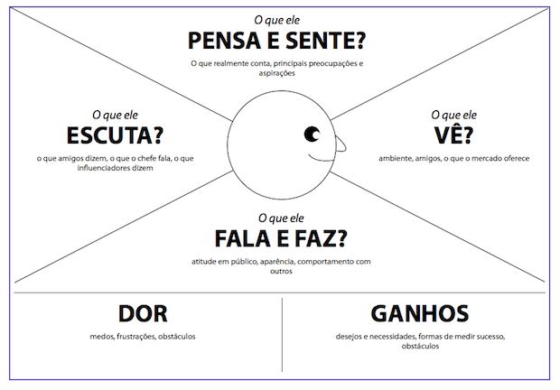
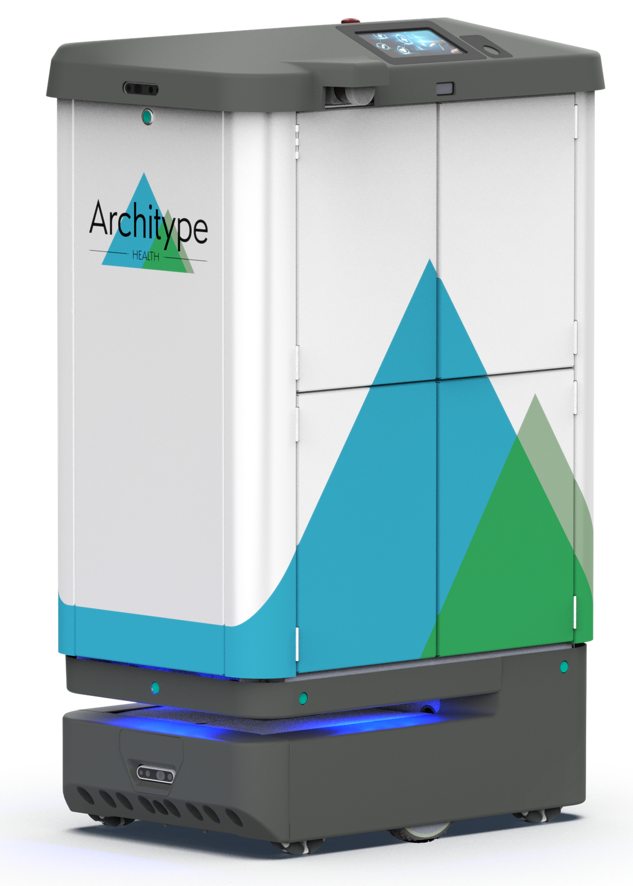
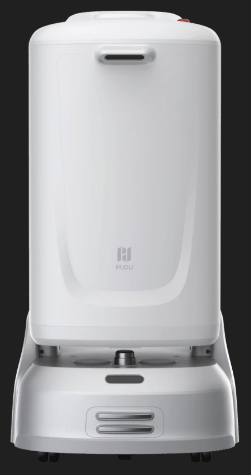
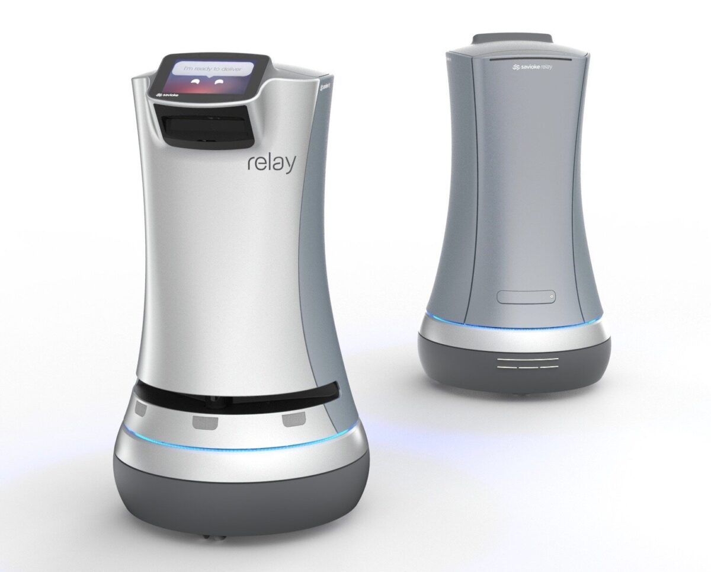

# **CareBot:** Melhoria de Projeto e Otimização da Cinemática Aplicada ao Projeto OmniCare

Trabalho de Interação Humano-Robô (IHR) apresentado ao Centro Universitário [FEI](https://portal.fei.edu.br/), como parte dos requisitos necessários para aprovação na disciplina de Interação Humano-Robô (IHR) (CCR230) do curso de Engenharia de Robôs, orientado pelo Prof. Dr. [Fagner de Assis Moura Pimentel](https://github.com/fagnerpimentel).

## Componentes do Grupo

- Luana Nascimento Karpavicius - 11.122.132-1
- Manuella Valles Egrejas - 11.122.138-8
- Gabriel Braga de Souza Otero - 11.122.155-2
- João Pedro Soares Cabral - 11.122.233-7

## Resumo

CareBot é um robô móvel autônomo desenvolvido para navegação em ambientes hospitalares. Derivado do projeto [OmniCare](https://github.com/Thgm01/OmniCare/tree/main), foi realizada uma reformulação para uma nova configuração mecânica com movimentação diferencial, oferecendo maior estabilidade e precisão. Equipado com um potente sensor LiDAR, o robô é capaz de mapear, se localizar e planejar rotas dentro de um ambiente, com potencial de aplicação em tarefas de assistência hospitalar como o transporte de materias e guias de pacientes. 

## Introdução

A crescente demanda por serviços de saúde, aliada à necessidade de reduzir riscos de contaminação em ambientes hospitalares, impulsiona o desenvolvimento de soluções tecnológicas capazes de contribuir nas rotinas clínicas. Nesse cenário, robôs móveis autônomos mostram-se como ferramentas promissoras para assumir tarefas logísticas repetitivas, como o transporte de medicamentos, materiais e amostras, aliviando os profissionais de saúde para atividades que exigem maior atenção e análise humana.

O CareBot é um robô móvel autônomo desenvolvido para navegação em ambientes hospitalares, capaz de mapear o espaço ao seu redor, localizar-se de forma idependente e planejar rotas seguras até destinos definidos pelo operador. Com sua configuração mecânica diferencial e tamanho compacto, proporcionando maior estabilidade e precisão de movimento em corredores, elevadores e espaços internos.

**Objetivo em uma frase:** atuar como assistente logístico hospitalar, realizando entregas e deslocamente de forma autônoma e segura.

**Experiência desejada:** interação simples, intuitiva e confiável, reduzindo a carga de trabalho da equipe hospitalar e contribuindo para um ambiente mais eficiente e seguro.

## Público-Alvo e Stakeholders

### Stakeholders

- **Primários** — Equipe de enfermagem e técnicos hospitalares, principais beneficiados pela redução de tarefas logísticas repetitivas.
- **Secundários** — Gestores hospitalares, interessados na redução de custos operacionais e aumento de eficiência; Médicos e profissionais da saúde, beneficiados pela maior disponibilidade da equipe de enfermagem; Pacientes, que teram seus exames ou medicamentos transportados pelo robô.
- **Anti-Usuários** — Financiadores e instituições de fomento, interessados no impacto e viabilidade do projeto; Staff interno do hospital, como faxineiros, manutentores e todos os envolvidos no ambiente de  operação do robô.

### Personas

- **Persona primária — Amanda, 34 anos:** técnica de enfermagem, trabalha em um hospital de médio porte e passa grande parte do turno transportando materiais entre alas, o que a afasta dos pacientes. Tem pouca familiaridade com tecnologia avançada e precisa de uma solução simples de operar, sem treinamentos longos. Seu principal interesse no CareBot é ganhar tempo para se dedicar ao cuidado direto dos pacientes.
- **Persona secundária — Dr. Roberto, 52 anos:** diretor administrativo do hospital e busca constantemente formas de reduzir custos operacionais e melhorar a eficiência dos processos. Não interage diretamente com o robô, mas é o tomador de decisão sobre sua adoção. Seu interesse está nos indicadores de desempenho, retorno sobre investimento e conformidade com normas sanitárias.

### Mapa de empatia

#### Persona - Amanda
- **Vê:** Um ambiente hospitalar movimentado, com corredores longos e pacientes que precisam de atenção constante. Vê colegas sobrecarregados realizando tarefas administrativas e logísticas que poderiam ser delegadas.
- **Ouve:** Comentários de colegas sobre o medo de que a tecnologia substitua funções humanas. Orientações da chefia sobre eficiência e produtividade.
- **Diz e faz:** Passa grande parte do turno transportando materiais, medicamentos e amostras entre alas. Comenta com colegas que "falta tempo para cuidar dos pacientes de verdade".
- **Pensa e sente:** Sente-se sobrecarregada e frustrada com tarefas que considera abaixo de sua qualificação. No fundo, deseja ter mais tempo e energia para se dedicar ao que considera o verdadeiro propósito de sua profissão — cuidar de pessoas.
- **Dores:** Tempo excessivo gasto em deslocamentos e tarefas logísticas, cansaço físico ao final do turno por percorrer longas distâncias, sensação de não conseguir atender bem os pacientes por falta de tempo.
- **Ganhos:** Mais tempo disponível para o cuidado direto aos pacientes, redução do cansaço físico no turno de trabalho e maior satisfação profissional ao focar em atividades de maior valor.

#### Persona - Dr. Roberto
- **Vê:** Um hospital com custos operacionais crescentes e equipe constantemente sobrecarregada. Observa profissionais qualificados despendendo tempo em tarefas logísticas que poderiam ser automatizadas.
- **Ouve:** Pressões da diretoria por redução de custos e melhoria nos indicadores de qualidade. Relatos da equipe de enfermagem sobre sobrecarga de trabalho e desgaste físico.
- **Diz e faz:** Participa de reuniões estratégicas buscando soluções para otimizar processos internos. Analisa planilhas de custos operacionais e indicadores de desempenho da equipe.
- **Pensa e sente:** Sente a responsabilidade de modernizar o hospital sem comprometer a segurança dos pacientes e funcionários. Deseja que o hospital seja reconhecido como referência em inovação na área da saúde.
- **Dores:** Dificuldade em justificar o investimento inicial no robô para a diretoria, receio de problemas técnicos que possam interromper o fluxo hospitalar e incerteza sobre o tempo necessário para o retorno do investimento.
- **Ganhos:** Redução de custos operacionais com otimização da logística interna, melhora nos indicadores de satisfação de pacientes e funcionários, e posicionamento do hospital como referência em inovação tecnológica.

## Contexto de uso

O CareBot trabalha dentro de um hospital de médio porte com vários andares. A tarefa liga pontos de origem, como postos de enfermagem e alas de internação, a pontos de destino, como laboratório de análises clínicas, farmácia e CME. Para isso, o robô precisa passar por corredores longos e compartilhados por macas, cadeiras de rodas, carrinhos de medicação e de limpeza, pacientes com mobilidade reduzida; e elevadores que são espaços confinados e divididos com pessoas, a porta tem tempo de abertura limitado, a soleira tem vãos e desníveis.

## Jornada do usuário

**1. Solicitação (início da tarefa)**
- Amanda abre a interface (tela do posto ou tablet), escolhe *"Enviar material"*, define o destino *Laboratório – 1º andar* e a prioridade.

**2. Deslocamento até a usuária**
- O robô anda pelo **lado direito** do corredor, em velocidade reduzida. Ele passa por pessoas mantendo pelo menos a **zona pessoal (≥ 0,5–1,2 m)**. Se encontra pessoas conversando, contorna o grupo e **nunca passa entre elas**. Diante de quem anda devagar, reduz a velocidade e espera uma brecha.

**3. Aproximação e cumprimento**
- O robô chega **pela frente** de Amanda, dentro do campo de visão dela, e não por trás. Para a cerca de **1,2 m**, na fronteira entre a zona pessoal e a zona social de Hall, e vira a frente, onde ficam a tela e as prateleiras, na direção dela.

**4. Carregamento e confirmação**
- Amanda coloca as amostras na prateleira e toca em *"Confirmar envio"*.

**5. Navegação até o elevador**
- Se o caminho estiver totalmente bloqueado, o robô para, espera alguns segundos e diz: *"Com licença, posso passar?"*. Se continuar bloqueado, recalcula a rota.

**6. Uso do elevador (momento mais delicado)**
- **Espera:** o robô se posiciona **ao lado da porta, não na frente dela**, para não atrapalhar quem sai. Chama o elevador pela interface dedicada ou pelo acionamento físico do botão, conforme a solução escolhida.
- **Prioridade:** quando a porta abre, o robô avalia a ocupação com o LiDAR e a câmera. Se houver **maca, cadeira de rodas ou cabine cheia**, ele **cede a vez**: *"Pode ir, eu aguardo o próximo."* O LED fica **âmbar**.
- **Entrada:** com espaço livre, ele diz *"Com licença"* e entra devagar, atravessando a soleira em linha reta. A tração diferencial com rodas convencionais foi escolhida justamente para vencer esse desnível com estabilidade. Ele fica **junto ao fundo ou à lateral da cabine**, ocupando o menor espaço possível e com a frente virada para a porta.
- **Dentro da cabine:** o robô fica **parado e em silêncio**. Não gira nem se movimenta perto dos passageiros. A tela mostra *"Indo para o 1º andar"*, para que as pessoas entendam por que ele está ali.
- **Identificação do andar:** o andar é reconhecido pelo visor (visão computacional) ou pelo sinal da interface. Ao chegar, o robô **troca o mapa** para o do 1º andar.
- **Saída:** espera os passageiros mais próximos da porta saírem primeiro. Depois diz *"Com licença, este é meu andar"* e sai.

**7. Entrega no laboratório**
- O técnico retira as amostras e confirma na tela. O robô responde: *"Entrega concluída. Obrigado!"*

## Análise de concorrência

- **Aethon Zena RX (ST Engineering Aethon, EUA):** Sucessor do TUG T2 para farmácias e laboratórios, tem navegação com desvio de obstáculos e localização 8 vezes mais rápidas, mais de 10.000 polegadas cúbicas de capacidade (2,6 vezes a do T2), interface por toque que exige quase nenhum treinamento e 10 horas de operação contínua. O gabinete tem quatro compartimentos com trava independente, acessados por biometria ou PIN.

  

- **Pudu FlashBot (Pudu Robotics, China):** Pesa 55 kg, carrega 30 kg (15 kg por bandeja) e tem velocidade ajustável entre 0,5 e 1,5 m/s. Mede cerca de 54 × 53 × 105 cm e tem autonomia de 8 a 12 horas, com recarga automática. 

  

- **Relay (Relay Robotics, antiga Savioke):**, A versão Relay tem um compartimento único e trancável, indicado para entrega de medicamentos e amostras que exigem transporte seguro em hospitais. O software permite rastrear a cadeia de custódia e exigir senha para abrir o compartimento.

  

**1. Existe plataforma similiar, que atende o mesmo mercado e funcionalidades?**
O Zena RX Foi desenhado especificamente para o hospital, com foco em farmácia e laboratório.

- *Pontos positivos:*
  - A segurança é a mais completa dos robôs analisados. O gabinete é todo de metal, com portas travadas fisicamente, biometria e senhas individuais da equipe. 
  - Faz até 4 entregas seguras por viagem. Isso reduz o número de viagens. 
  - Integra-se com elevadores de todas as marcas e com sistemas de portas         automáticas. 
  - A capacidade é de cerca de 164 L, o que permite levar desde frascos pequenos até caixas grandes na mesma viagem, e há exigência de dupla autenticação na cadeia de custódia. 
  - No laboratório, a proposta é evitar o sistema de tubos pneumáticos. 

- *Pontos negativos:*
  - O site não divulga preço e direciona para agendar uma conversa comercial. 
  - É especializado em farmácia e laboratório. Para transportar carrinhos inteiros, a Aethon oferece outro modelo, o T3. O cliente teria de combinar robôs diferentes. 
  - É um produto fechado e importado. Isso implica custo alto, dependência do fabricante para suporte e pouca possibilidade de adaptação ao contexto brasileiro.

**2. Existe plataforma diferente quanto ao serviço, mas que atenda esse mercado?**
O FlashBot nasceu como robô de entrega de prédios (hotéis e escritórios), mas também é oferecido para hospitais.

- *Pontos positivos:*
  - É anunciado para transportar medicamentos, refeições, roupa de cama e suprimentos entre andares. 
  - Usa IoT em nuvem para chamar elevadores automaticamente, e vários robôs podem cooperar entre si. 
  - Os compartimentos são ajustáveis (de dois a quatro) e têm acesso seguro. 
  - Tem escala de produção grande: quase 80 mil unidades enviadas para mais de 60 países. 
  - A versão atualizada também opera em áreas semiexternas, como jardins de hospitais. 
  - O custo tende a ser menor: um revendedor lista o robô a US$ 20.000, com a observação de que preços na América Latina podem variar. 

- *Pontos negativos:*
  - É um robô generalista.Não dispôe recursos hospitalares como biometria ou rastreio de cadeia de custódia, que o Zena RX e o Relay oferecem.
  - A carga de 30 kg e os compartimentos de bandeja atendem melhor a suprimentos leves do que a materiais clínicos sensíveis.
  - Não contém informações suficiente sobre conformidade com normas sanitárias, o que seria necessário verificar antes de uma aplicação hospitalar real.

## Design do Robô

### Forma, função e affordances

> 💡
> - Pense nas características de affordances do seu robô. Que tipo de acessibilidades devem ser consideradas dentro do seu projeto?
> - A aparência e o comportamento do robô **casam com a função**? Que affordances a forma sinaliza (olhos → enxergar, braços → pegar objetos, tela → interagir por toque)?
> - Discuta o papel das expectativas do usuário no projeto de um robô. Onde faz sentido "**prometer menos e entregar mais**" (underpromise, overdeliver)?

📄

O Rumo tem uma tela no "peito" (affordance de toque), uma "cabeça" com dois pontos luminosos (olhos) que sinalizam para onde está olhando, e **não** tem braços — o que sinaliza corretamente que ele não manipula objetos, apenas informa e guia. Para "prometer menos, entregar mais", o robô nunca é chamado de "assistente inteligente" nos materiais do evento, apenas de "guia do FEI Portas Abertas", evitando a expectativa de uma conversa livre e aberta.

### Grau de antropomorfismo

> 💡
> - O seu robô tem um padrão com mais ou menos características antropomórficas (androide, humanoide, zoomórfico, minimalista, robject)? Marquem um ponto no espectro máquina ↔ humano e justifiquem.
> - Qual padrão é mais aceito pela sociedade dentro do projeto que você está desenvolvendo?
> - Como o grupo pretende evitar o **vale da estranheza** (uncanny valley), caso o robô tenha um design muito próximo do humano?

📄

O Rumo fica próximo do polo **minimalista** do espectro, com leve antropomorfismo (olhos, "cabeça" que gira), sem rosto detalhado nem fala emocional complexa — parecido com o Keepon citado na aula de Design. Justificativa: um design fortemente humano geraria expectativa de conversa fluida, que o robô não tem; pouco antropomorfismo, por outro lado, dificultaria que visitantes se sintam à vontade para abordá-lo. Por ficar longe do polo humano, o risco de vale da estranheza é baixo.

### Padrões de design

> 💡
> Identifique **2 padrões de design** (design patterns) aplicáveis ao seu projeto e explique como eles se **combinam**.

📄

**"Apresentação inicial"** (o robô se apresenta brevemente antes de perguntar o destino) + **"em movimento junto"** (anda ao lado/à frente do grupo, ajustando o ritmo ao visitante mais lento) — combinados, formam o padrão composto de "robô guia turístico".

### Valores e ética

Dois valores importantes para o CareBot são segurança e privacidade. A segurança deve orientar o planejamento das rotas e o comportamento do robô diante de obstáculos e pessoas. Já a privacidade deve ser preservada, evitando a coleta ou o armazenamento desnecessário de informações pessoais dos pacientes e profissionais.

Um risco ético é que o robô provoque acidentes ou bloqueie a passagem em áreas de grande circulação, principalmente quando houver pacientes com mobilidade reduzida. Para reduzir esse risco, o CareBot deve operar com velocidade controlada, manter distância adequada das pessoas e priorizar a parada quando não houver condições seguras para continuar.

### Protótipo no papel

> 💡
> Modele o seu robô com desenhos de formas primitivas (caixas, cilindros, esferas): forma, tamanho, rosto/olhos, partes móveis, tela. É o protótipo mais barato e rápido — lembre-se do lema "**teste cedo, teste sempre**".
>

📄

 Corpo afunilado sobre uma base omnidirecional (três rodas onidirecionais, em arranjo triangular); "cabeça" arredondada com dois olhos, uma antena/sensor no topo; tela na parte de cima do torso, com o nome do robô; sem braços — apenas um anel de luz na base para sinalizar status. Altura total ≈1,55 m; diâmetro da base ≈0,90 m.

## Ações do robô

> 💡
> Para cada ação:
> - Descreva a ação.
> - Determine os pré-requisitos para que a ação aconteça
> - Determine o que se espera que seja modificado no ambiente quando a ação é finalizada

📄

**Guiar até o destino** — pré-requisito: destino escolhido no menu e caminho livre conhecido no mapa do dia. Ao finalizar: o visitante está fisicamente no laboratório e o robô retorna à posição de espera no saguão.

**Dar informação rápida** — pré-requisito: pergunta reconhecida dentro do conjunto de perguntas frequentes cadastradas. Ao finalizar: a resposta foi falada e também exibida na tela.

## Interações do robô

### Espacial

> 💡
> - Descreva **onde** o robô se posiciona em relação ao usuário (distância e orientação do corpo), usando as **zonas de proxêmica** (Hall) e as **F-formations**.
> - Como o robô **inicia** a interação (direção de aproximação) e como **sinaliza** para onde vai?
> - Para cada interação espacial:
>   - Descreva a interação.
>   - Determine os pré-requisitos para que a interação aconteça.
>   - Determine a resposta emocional esperada do usuário quando a interação é finalizada.
> - O que o robô faz ao encontrar pessoas **paradas, em conversa ou em grupo**, e ao passar por elas num corredor (sem cruzar entre pessoas conversando)?
> - Proponha **um ajuste** desse comportamento espacial para um contexto de uso diferente do principal.

📄

- **Posicionamento:** aborda o grupo a uma distância social (2–3 m), sempre pela frente, nunca por trás.
- **Início da aproximação:** aproxima-se em diagonal (nunca em linha reta "contra" a pessoa), reduzindo a velocidade a 1,5 m de distância.
- **Sinalização de destino:** gira a "cabeça" na direção do laboratório antes de começar a andar.
- **Grupos e corredores:** ao encontrar duas pessoas conversando, contorna por trás delas, sem passar entre as duas; para grupos maiores, aguarda uma abertura natural na formação.
- **Ajuste de contexto:** em dias normais de aula (sem evento), o robô aumenta a distância de abordagem, já que há menos ruído social e mais espaço livre no saguão.

### Verbal

> 💡
> - A interação verbal do robô será **restrita** (comandos, FSM) ou **aberta** (LLM/chatbot)? Justifique a escolha.
> - Para cada interação verbal:
>   - Descreva a interação.
>   - Determine os pré-requisitos para que a interação aconteça.
>   - Determine a resposta emocional esperada do usuário quando a interação é finalizada.
> - Como o robô lida com o **timing** das respostas (silêncio, marcadores conversacionais como "uh-huh")?
> - Que tipo de voz (TTS) o robô usa, e por que ela **combina** com a aparência e o propósito dele?
> - Identifique **uma limitação** do reconhecimento de fala (ruído, sotaque, vocabulário) que afetaria o seu cenário de uso, e como mitigá-la.

📄

**Restrita** — usa uma árvore de diálogo (FSM) com um conjunto fechado de destinos e perguntas frequentes, pois o saguão é ruidoso e o vocabulário esperado é previsível; mais confiável do que abrir para um LLM.

**Timing:** ao processar um pedido, o robô emite um "hum" sonoro curto e pisca os olhos em sequência, evitando silêncio constrangedor.

**Voz:** TTS de tom jovem e neutro, volume ajustável ao ruído do saguão — combina com o porte pequeno do robô (uma voz grave soaria estranha).

**Limitação do ASR:** o ruído do evento atrapalha o reconhecimento de nomes de professores e disciplinas. **Mitigação:** escolhas críticas (curso, laboratório) são feitas por toque na tela; o reconhecimento de fala só é usado para perguntas simples de sim/não.

### Não-verbal

> 💡
> - Escolha **dois canais** não verbais (olhar, gesto, toque, postura, ritmo, imitação) e descreva como o robô os usaria.
> - Para cada interação não-verbal:
>   - Descreva a interação.
>   - Determine os pré-requisitos para que a interação aconteça.
>   - Determine a resposta emocional esperada do usuário quando a interação é finalizada.
> - Explique como o robô **perceberia** as pistas não verbais correspondentes da pessoa.
> - Descreva um caso em que a **falta de coordenação** entre fala e comportamento não verbal quebraria a interação.
> - Proponha **uma pista não verbal exclusiva** do robô (sem equivalente humano direto) que ajudaria na comunicação.

📄

**Canais escolhidos: olhar e postura.**
- **Olhar:** os "olhos" de LED giram na direção de quem está falando com o robô e na direção da rota a seguir.
- **Postura:** o corpo se inclina levemente para frente ao iniciar a aproximação (convite) e se afasta/gira de lado ao encerrar a interação (despedida).

**Percepção:** uma câmera de profundidade detecta se a pessoa está olhando para o robô (atenção) e se está parada olhando ao redor (sinal de estar perdida).

**Falta de coordenação:** se o robô disser "vamos ao laboratório de robótica" mas girar para o lado errado, o grupo hesita e para de segui-lo — a confiança se quebra.

**Pista exclusiva do robô:** um anel de luz na base pisca em verde quando o robô está confiante do caminho e em amarelo quando está recalculando a rota — sem equivalente humano direto, mas comunica incerteza de forma clara.

## Emoção

> 💡
> - Escolha um **modelo de emoção** (categorias básicas de Ekman, modelo OCC ou modelo dimensional — Russell ou PAD) e justifique a escolha para o seu caso de uso.
> - Descreva **como** o robô perceberia o estado emocional do usuário, e por quais canais (rosto, voz, postura, outro).
> - Defina **quando** o robô deve mimetizar a emoção da pessoa e **quando não deve** (lembre-se da exceção da raiva — retribuir raiva raramente ajuda a resolver o conflito).
> - Identifique um risco de **gerenciamento de expectativas**: se o robô parece emocionalmente responsivo, que outras capacidades sociais o usuário passa a esperar dele? O robô consegue cumprir essa expectativa?

📄

**Modelo:** categorias básicas de Ekman (feliz, surpreso, neutro) — simples o suficiente para expressar por luzes e tom de voz, sem exigir um rosto detalhado.

**Percepção:** o robô reconhece tom de voz alterado (frustração) pelo microfone e expressões faciais básicas pela câmera, para saber se o visitante está confuso ou satisfeito.

**Mimetismo:** mimetiza entusiasmo — se o visitante se anima ao ver o laboratório de robótica, o robô "sorri" com as luzes — mas **nunca** mimetiza a impaciência de um visitante apressado; nesse caso mantém tom calmo e oferece um caminho mais curto.

**Risco de expectativa:** se o robô demonstra "empolgação", visitantes podem esperar que ele converse sobre assuntos abertos (ex.: "e as notas de corte?"). O robô precisa deixar claro, de forma simpática, quando um assunto está fora do seu escopo.

---                                                                                                                                                                                                                                                                                                                                                                                                                                                                                                                                                                                                                                                                                                                                     
[^1]: Fonte: Adaptado de <https://hazeshift.com.br/mapa-de-empatia/>

